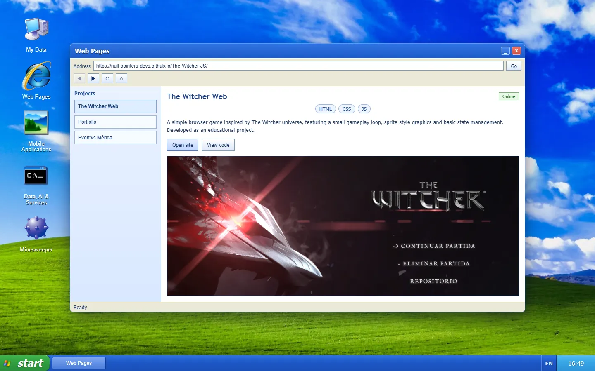
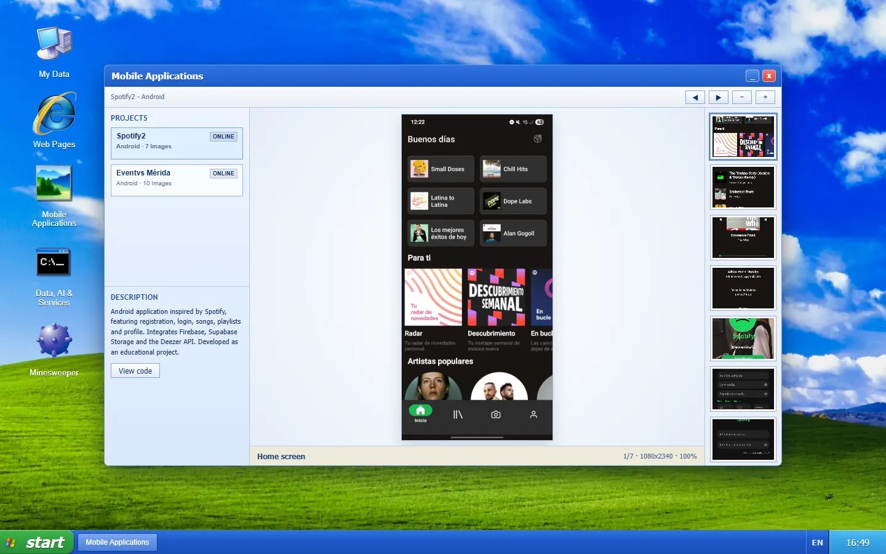
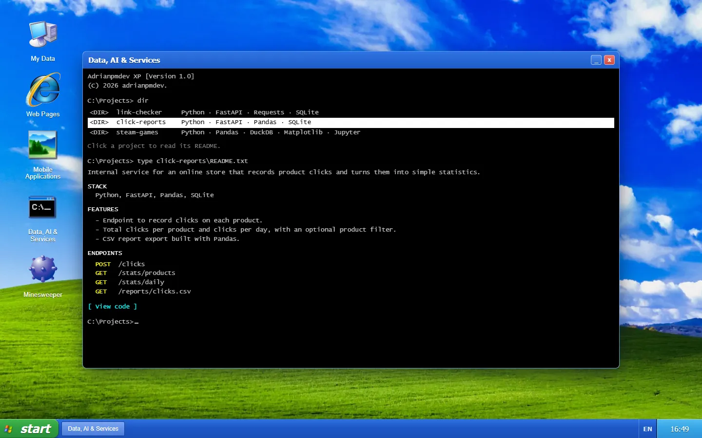
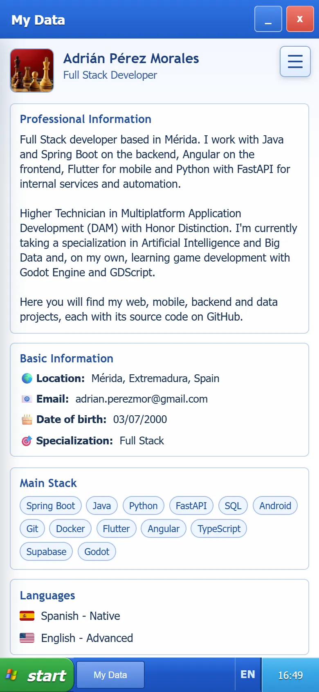
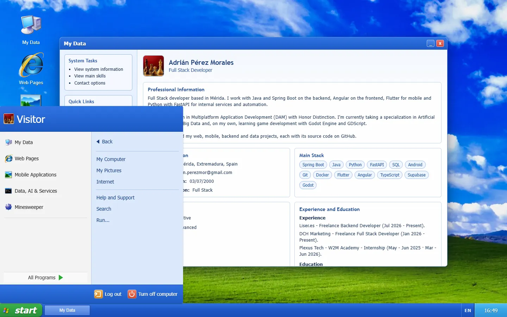
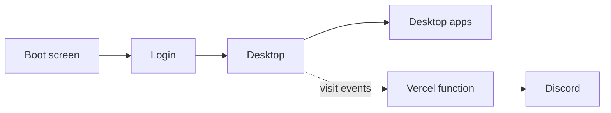

<div align="center">

# 🖥️ Portfolio XP

### A personal portfolio that brings the Windows XP experience to the web


[](https://adrianpmdev-portfolio.vercel.app/)
[](https://github.com/adrianpmdev)

[Description](#-description) · [Screenshots](#-screenshots) · [Features](#-features) · [Tech Stack](#️-tech-stack) · [Project Approach](#️-project-approach) · [Project Structure](#-project-structure) · [Documentation](#-documentation) · [License](#-license)

</div>

---

<br>

## 🌐 Live Demo

👉 **[adrianpmdev-portfolio.vercel.app](https://adrianpmdev-portfolio.vercel.app/)**

---

<br>

## 📖 Description

Personal portfolio built with **Angular** that recreates the visual experience of **Windows XP** in a web format.

The project combines a retro interface (**boot screen, login, desktop, windows and Start menu**) with an interactive presentation of projects and skills.

> 🕹️ **Boot → Login → Desktop**: the full XP experience, adapted to a modern context.

---

<br>

## 📸 Screenshots

<p align="center">
  
</p>

<table>
  <tr>
    <td width="40%"></td>
    <td width="40%"></td>
    <td width="20%" rowspan="2"></td>
  </tr>
  <tr>
    <td align="center">Mobile projects in the Photo Viewer</td>
    <td align="center">Projects without a UI in the console</td>
  </tr>
  <tr>
    <td colspan="2"></td>
    <td align="center">Mobile layout</td>
  </tr>
  <tr>
    <td colspan="2" align="center">Start menu and profile</td>
    <td></td>
  </tr>
</table>

---

<br>

## 🎯 Purpose

- 🌟 **Showcase** personal projects through a more original and memorable experience than a traditional portfolio.
- 🧩 **Demonstrate** frontend development skills with a modular architecture, strong typing and separation of responsibilities.
- 🌍 **Apply** internationalization and animations to improve the user experience.
- 🎨 **Keep** a consistent Windows XP-inspired aesthetic, adapted to a modern context.

---

<br>

## 🚀 Features

- 🖥️ **XP experience**: boot screen, login, desktop with windows, taskbar and Start menu.
- 👤 **My Data**: profile, main stack, experience and education, contact links and two CVs (summary and detailed).
- 🌐 **Web Pages**: web projects with a preview, a link to the live site and a link to the code.
- 📱 **Mobile Applications**: screenshots of the mobile apps with thumbnails, zoom and keyboard shortcuts.
- 💻 **Data, AI & Services**: projects without a user interface (APIs, internal services, data analysis) shown as a console README.
- 💣 **Minesweeper**: playable with the mouse, touch screens and the keyboard.
- 🌍 **Two languages**: Spanish and English, switched without reloading the page.
- ♿ **Accessible and responsive**: fully usable with the keyboard; on phones, windows open fullscreen.
- 🔔 **Visit notifications**: desktop visits, CV downloads and LinkedIn clicks are forwarded to Discord by a Vercel function.

---

<br>

## 🛠️ Tech Stack

| Technology                                                                                                                  | Purpose                                                               |
| --------------------------------------------------------------------------------------------------------------------------- | --------------------------------------------------------------------- |
|                    | Core framework: standalone components, signals, zoneless              |
|              | Typed language                                                        |
|                                | Styling                                                               |
|     | UI components (menus, progress bars, ripples)                         |
|                           | Animations                                                            |
|  | Internationalization (🇪🇸 ES / 🇬🇧 EN)                                  |
|                          | Hosting and serverless function that forwards visit events to Discord |
|                          | Linting with angular-eslint rules                                     |
|                    | Code formatting                                                       |
|                             | Image conversion to WebP (`npm run images`)                           |

---

<br>

## 🏗️ Project Approach

| Folder           | Content                                                                      |
| ---------------- | ---------------------------------------------------------------------------- |
| `core/`          | App-wide singletons with no UI: analytics, device, fullscreen, i18n, session |
| `shared/`        | Pieces used by several features: author profile, project status and its pipe |
| `features/`      | Boot, login and desktop routes, and the desktop apps                         |
| `features/apps/` | One folder per app, each with its manifest and its data files                |



- 🧱 **Standalone components**, following the official [Angular style guide](https://angular.dev/style-guide) (feature folders, no type suffixes).
- 🧩 **Pluggable apps**: each app lives in its own folder with a manifest (`<app>-manifest.ts`). Adding one means creating its folder and listing its manifest in `features/apps/app-registry.ts`; the desktop, Start menu and taskbar pick it up automatically and its code is lazy-loaded.
- 🗂️ **Data-driven content**: web, mobile and UI-less projects, experience and education, and the main stack live in typed `*-data.ts` files, so adding content doesn't require touching any component.
- 🔐 **Client-side session**: the stored user name controls the boot / login / desktop flow.
- 🎭 **Visual narrative**: the interface is focused on the visual experience of the portfolio.
- 📱 **Responsive design**: on mobile, windows are displayed fullscreen and stacked, like native app screens.
- ⚡ **Zoneless, signals and OnPush**: the app runs without `zone.js`; component state lives in signals and every component uses `OnPush` change detection.

---

<br>

## 📁 Project Structure

```text
src/app/
├── app.ts · app.config.ts · app.routes.ts
│
├── core/                             # App-wide singletons, no UI
│   ├── analytics/                    # Event logging
│   ├── device/                       # Device category and platform detection
│   ├── fullscreen/                   # Browser fullscreen
│   ├── i18n/                         # Supported languages and language settings
│   └── session/                      # User session
│
├── shared/                           # Pieces used by several features
│   ├── profile/                      # Author contact details (single source)
│   └── project-status/               # Project status model + label pipe
│
└── features/
    ├── boot/                         # Boot screen route
    ├── login/                        # Login route
    │
    ├── desktop/                      # Desktop route
    │   ├── desktop.ts
    │   ├── desktop-guard.ts          # Protects the desktop route
    │   ├── window-manager.ts         # Window state (open, minimized, focus, z-order)
    │   ├── desktop-window.ts
    │   ├── desktop-icon/
    │   ├── start-menu/               # XP Start menu
    │   ├── taskbar/                  # Start button, window tabs, language, clock
    │   └── xp-window/                # XP window frame that lazy-loads each app
    │
    └── apps/                         # Desktop applications
        ├── app-definition.ts         # Contract every app implements
        ├── app-registry.ts           # List of installed apps
        ├── app-window.ts             # Window context provided to each app
        ├── my-pc/
        │   ├── my-pc-manifest.ts
        │   ├── skills-data.ts             # Main stack
        │   └── career-data.ts             # Experience and education
        ├── internet-explorer/
        │   ├── internet-explorer-manifest.ts
        │   └── web-projects-data.ts       # Web projects
        ├── photo-viewer/
        │   ├── photo-viewer-manifest.ts
        │   └── mobile-projects-data.ts    # Mobile projects
        ├── command-prompt/
        │   ├── command-prompt-manifest.ts
        │   └── console-projects-data.ts   # Projects without a UI (APIs, data)
        └── minesweeper/
            ├── minesweeper-manifest.ts
            └── minesweeper-engine.ts      # Game logic, UI-independent
```

---

<br>

## 📚 Documentation

| Document                                                                 | Content                                                                                                                           |
| ------------------------------------------------------------------------ | --------------------------------------------------------------------------------------------------------------------------------- |
| [Technical Manual](docs/Portfolio%20%E2%80%94%20Technical%20Manual.docx) | Architecture, desktop shell and apps, translations, event logging, tooling, setup and deployment, and how to add apps and content |

---

<br>

## 📄 License

Source code licensed under the **MIT License**. Personal content and Windows XP assets are excluded. See [LICENSE](LICENSE) and [NOTICE](NOTICE) for details.

---

<br>

## 👤 Author

[@adrianpmdev](https://github.com/adrianpmdev) · Junior Full Stack Developer

---

<br>

<div align="center">

✨ Made in **2026** by [@adrianpmdev](https://github.com/adrianpmdev) ✨

</div>
